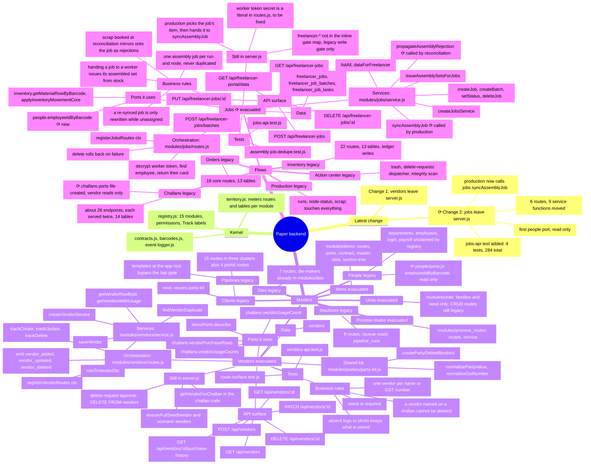

# 11 · Backend mind map

One map of the backend, updated with every change. It reads from the business
down to the code: each module breaks into what the business needs from it, the
API it exposes, the handlers that serve it, the service functions behind those,
the ports it shares with other modules, the tables it owns and the tests that
pin it.

Nodes touched by the latest change carry **⟳**. Modules that have left
`server.js` say `evacuated`; the rest say `legacy`. Only the modules that have
been through a change are expanded; the others show what the registry knows.

Source of truth for module identity is `backend/kernel/registry.js`; this map
is what a person reads first, the registry is what the server reads.

## Layers, top to bottom

| Layer | Question it answers | Where it lives |
|---|---|---|
| Business rules | What must always be true? | service functions, guards |
| API surface | What can a client ask? | `modules/<name>/routes.js` |
| Orchestration | Which steps run for one request? | route handlers, `register<Name>Routes(ctx)` |
| Services | What are the reusable operations? | `modules/<name>/service.js` |
| Ports | What may another module ask of this one? | `modules/<name>/ports.js` |
| Data | What is stored? | tables in `registry.js` |
| Tests | What pins the behaviour? | `backend/test/*.test.js` |

## The map

## Change log

| # | Change | Layers touched |
|---|---|---|
| 1 | Vendors leave `server.js`. Adds `modules/vendors/{routes,service}.js`, `modules/parties/party-kit.js`, `modules/challans/ports.js`; adds `vendors-api` and `route-surface` tests; registry flag `evacuated: true`. | API surface (unchanged paths), Orchestration, Services, Ports, Tests |
| 2 | Jobs leave `server.js`. Adds `modules/jobs/{routes,service}.js` and `modules/people/ports.js`; production's job write and reconciliation's rejection mirror now call the jobs service; adds `jobs-api` test; registry: jobs `evacuated: true` plus its real path segments (meter only). | API surface (unchanged paths), Orchestration, Services, Ports, Tests |
