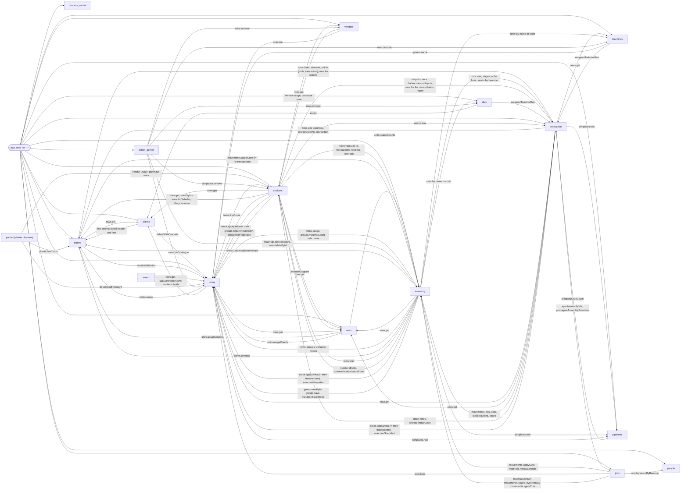

# 12 · Modules as services — plan, checklist, progress and bugs

This is the working record of turning Paper's modules into separate services.
It is edited with every change, so the plan, what is done, how the work went and
what was found along the way are all here and nowhere else. If a conversation is
lost, start from this file.

Last updated: 2026-11-19 (P0 done: main fast-forwarded and pushed; the packages P1-P8 are listed under "Next").

## 1. The plan

### Why

Paper has to be sellable in parts. One client takes only Orders, another only
Production, another a combination. So every module (orders, production,
inventory, challans, each master) becomes its own service, with its own API,
behind its own wall.

### The kingdom, in Paper's terms

| Kingdom | In Paper |
|---|---|
| Kingdom | One client's deployment |
| Neighbourhood | A module running as its own service |
| Wall | The service answers nothing that does not come through its gate |
| Gate | The service's API: one named operation per thing it can do |
| Pass | A signed token saying which service is calling, for which operation, for which user |
| City gate | One gateway, the only door the app and the outside can reach |
| Messenger | The kernel desk (`backend/kernel/desk.js`), which carries a call from one module to another |

### The ladder

| Level | Meaning | State |
|---|---|---|
| Function | A module's work, callable by name with no request | Built for process routes and orders |
| Feature | Function + API + screen inside Paper | What the app is today |
| System | A chosen set of modules deployed alone for a client | Stage 3 |

### Order of work, and why

A wall around a module is only real if the module has a contract for everything
it is asked, and does not share its tables. Neither is true yet. Splitting into
separate processes first would only move the tangle onto the network. So:

1. **Stage 0** — remove the terminal program (not wanted now).
2. **Stage 1** — API contracts for every module.
3. **Stage 2** — database decoupling, still in one database file.
4. **Stage 3** — the walls: gates, passes, a service map per client, modules as
   separate processes, a gateway, and last a database per service. Not yet
   planned in detail and not yet approved.

### Decisions taken

| Date | Decision |
|---|---|
| 2026-11-17 | Go to the function level first, then system. |
| 2026-11-18 | Contracts and database decoupling come before gates, passes and separate processes. |
| 2026-11-18 | One database file until stage 2 is finished; a database per service only after. |
| 2026-11-18 | The terminal program (`bin/paper.js`) is removed. The desk stays. |
| 2026-11-18 | Calls between modules stay inside one process until stage 3, so operations that share a transaction (challan issue, order delete) keep working. |
| 2026-11-18 | Contracts are enforced for every operation. `PAPER_CONTRACTS_MODE=report` turns enforcement off on a running installation without a code change. |
| 2026-11-18 | A contract says what a field is and what is plainly required; it does not repeat a master's own rules, which keep answering in their own words. |

### Decisions taken on 2026-11-19

- The rest of the sandbox control plane goes: `/sandbox-config`, `/api/sandbox-sync`,
  `/api/session-replay`, `/api/activation/*`, and the update feed that read the
  sandbox config. The desktop app stops calling them and loses its activation gate.
  socket.io stays (the mobile app depends on it) but requires the login token.
- The freelancer portal keeps requiring a login; the card link is a shortcut for a
  signed-in worker, not a credential on its own.
- Contracts: every field typed, including the fields of bodies handed whole to a
  service; required only where the code already refuses.
- `main` is fast-forwarded to this work and pushed, which deploys staging.

### Waiting for a decision

- Stage 3 itself: which modules a real client needs split, and whether any
  module ever needs its own machine.

### Staging watch list

After the deploy of 2026-11-19, with the app in real use:

- `GET /api/kernel/guard-alerts`: any entry whose route reads
  `operation <name> (input, enforce)` is a request the app made that a contract
  refused. Each is either a contract to loosen (and the evidence run to repeat) or
  a client bug; decide per case and record it here. `PAPER_CONTRACTS_MODE=report`
  turns enforcement off without a code change if the app is blocked.
- Job cards printed before the deploy no longer open the freelancer portal and must
  be reprinted.
- The server log on first start says `Hashed N portal password(s) that were stored
  as plain text.` once, and never again.
- The deploy on the previous `main` (d9ba926) had failed; confirm this one succeeds.

### Stage 1 — API contracts for every module

**1a. Make contracts mean something.** In the desk: output contracts; two
strictness modes per operation (`report` records a violation and carries on,
`enforce` refuses it); a contract catalogue with a snapshot test so any contract
change is a visible diff.

**1b. Convert the 13 remaining modules.** One module per commit:

1. `modules/<name>/operations.js`: operations offered to users, and everything
   other modules ask of it as internal operations.
2. Its routes ask the desk. HTTP answers must not change.
3. Every module that was handed its ports or helpers asks the desk instead, and
   declares the name in its `uses` list.
4. Typed input and output contracts, starting in `report` mode.

Order: units → vendors, clients, people, machines, dies, pipelines → production
→ inventory → challans → items → jobs, action center.

Done when `server.js` hands nothing from one module to another.

### Stage 2 — database decoupling (one file)

**2a. Measure it and stop it growing.** Finish table ownership in
`kernel/registry.js`. A test scans every module's SQL for tables owned by another
module; today's violations go in a list that may only shrink.

**2b. Burn the list down.** Each read of another module's table becomes a call to
the owner. Reports that join several modules keep their SQL but declare each
foreign table in a `reads` list.

**2c. Writes across modules.** A module never writes another's table; it asks the
owner. Operations that must run in the caller's transaction are marked, which
later tells stage 3 which modules cannot be split apart. Cascades across module
lines become explicit calls.

**2d. Each module creates its own tables** in `modules/<name>/schema.js`, moved
out of `initDb` in `server.js`.

Done when the violation list holds only declared `reads`, no module writes a
table it does not own, and `initDb` holds no business table.

### First build (done 2026-11-18)

Stage 0, stage 1a, stage 2a, and units taken through 1b and its share of 2b. That
gives the two measuring instruments and one module done to the full standard, so
the remaining twelve are a known amount of work.

### Next

Stage 1b is done for all 15 modules: every one publishes its operations, its
routes ask the desk, and no module is handed another's ports. What is left:

The packages, in order (approved 2026-11-19; P0 is done):

| # | Package | State |
|---|---|---|
| P0 | Merge to main and push; `encrypt` package dropped; this doc's dates fixed; staging watch list | done |
| P1 | Remove the rest of the sandbox control plane (server and desktop app); socket.io requires the login token | |
| P2 | Tests remove their temporary databases (B24) | |
| P3 | Typed contracts for every operation, per module, each with an evidence run | |
| P4 | Orders' 11 and process routes' 2 undeclared reads become asks or declared reads | |
| P5 | Items logic out of `server.js` into `modules/items` (~2,700 lines, 4 commits) | |
| P6 | Kernel-side crossings: 17 kernel-service touches of module tables, 8 module touches of kernel tables | |
| P7 | Writes across modules get transactions (stage 2c); cascades deferred | |
| P8 | Each module creates its own tables (stage 2d), behind a schema snapshot test | |

Not in these packages: stage 3 (walls), an event bus, and replacing cross-module
`ON DELETE CASCADE` with explicit calls.

### Left as they are, on purpose

| Routes | Why they call something other than an operation |
|---|---|
| Machine and die photos (6) | They call the kernel's asset service, which is not another module |
| Order PO documents (5) | Mostly S3 presigning; to do with the rest of orders |

### How to convert a module (the recipe units followed)

1. Move any of its logic still in `server.js` into the module; leave one-line
   function declarations behind for seeds and tests that call the old names.
2. Write `modules/<name>/operations.js`: user operations with the permission
   the HTTP gate already asks for, internal operations for what neighbours ask.
3. Make the routes ask the desk. They receive `desk`, never the database.
4. Replace every read of another module's table with an internal operation on
   the owner, and declare it under the caller's `uses` in `server.js`.
5. Typed input and output contracts, in `report` mode.
6. Run the suite, then record the two snapshots:
   `UPDATE_CONTRACT_SNAPSHOT=1` and `UPDATE_BORDER_SNAPSHOT=1` (the second
   refuses a list that grew).
7. Update this file and the mind map.

Traps met so far:

- An operation's permission must be the key the central gate asks for on that
  path, or users with unusual grants get a different answer. The gate treats
  every POST as `create`; a POST that only reads needs an exception in
  `moduleOpForRequest`.
- A path whose first segment maps to no module is not gated by module at all.
  Declare the segment (as `unit-groups` was) before giving its operations a
  permission.
- Keep input contracts loose or in `report` mode where the service already
  validates, or an HTTP answer changes.
- Internal operations must let the service's errors throw; their callers run
  inside their own transactions and want the original error.
- A body that carries its own `id` (a machine or die upsert, a pipeline
  template) must not be spread next to the path's id. Pass it whole, or under
  `data`.
- Some routes answer a refusal with extra keys (`client: null`, `code: null`)
  and some with the error alone. Keep each route's own failure body; do not
  send one generic refusal for all.
- A route that was never behind a module permission needs an operation that
  asks what its own guard asked, not a new permission. The desk has three
  rules for that besides `permission`: `access: 'signedIn'` (any signed-in
  user), `access: { anyRole, anyPermission }` (a role in the list or any one
  key; this is how the old write gate is expressed), and `roles: [...]` on top
  of either (an employee's login is admins only).
- Read a guard's code before trusting a comment about it. The portal routes'
  own header said they were open to any signed-in session; the old write gate
  in front of them lets only an admin, `config.write` or `inventory.update`
  make a POST.
- When a module's logic lives inside its HTTP handlers (production had about
  900 lines there), move it mechanically: each handler becomes a function of
  a plain `req` that returns `answer(status, body)` instead of sending. Then
  check every site: a nested helper that used to send and whose caller then
  did a bare `return` now returns nothing. Production had one.
- A read that cannot be split without changing a filtered, paged query is
  declared, not hidden: `reads: { table: 'why' }` in the module's manifest in
  `kernel/registry.js`. The meter marks it "(declared)" and counts it apart.
- Each full test run leaves about 800 throwaway database folders (about
  1.2 GB) in the system temp folder; nothing removes them (bug B24). Clear
  `paper-*` there after a run, or the disk fills in a day of work.
- Two operations in one module must not share a name. A module's operations
  are one object, so the later key silently replaces the earlier: production
  asking inventory to apply a movement was answered by the user's operation of
  the same name. Build internal and user operations separately and refuse a
  clash (see `modules/inventory/operations.js`).
- When a module is handed a client in place of ports, every function on it is
  asynchronous. A port that was a plain function and was called without
  `await` (inventory's `sources.propose`) then yields a promise. Search the
  callers for port calls that are not awaited.
- A module with many callers written against its ports can keep them
  unchanged: list what it offers once (`modules/inventory/asks.js`), build the
  internal operations and a client of the same shape from that list
  (`client.js`), and hand each caller the client made from its own desk
  handle. Track entries a moved handler wrote ride on the result as `track`
  and are written by the route (`deskRoutes` in `kernel/desk-kit.js`).
- A handler that sends its answer and then does more work (challan issue and
  cancel broadcast a stock change after answering) cannot simply `return` the
  answer: the work after it would be skipped. Decide the answer, do the rest
  in a way that cannot change it, then return it. The move script reports
  every site with code after an answer; never ignore that line.
- Names a route file imported at the top (`barcodes`) do not move with the
  handler bodies. Carry the imports to the work file.
- Keep routes in their original order when regenerating a route file: Express
  matches the first registration, and `/scans` before `/:id` is not a detail.
- A handler that sends a file answers with `answerFile`; the result carries
  `file` and `deskRoutes` sends it.
- `operationsFromAsks`, `clientFromAsks` and `joinOperations` in
  `kernel/desk-kit.js` are the shared form of inventory's asks and client. A
  port that returns a Map says `returns: 'map'`; it crosses as pairs.
- A guard like `if (trackCreate) trackCreate(...)` leaves `if (trackCreate)`
  behind when the call becomes `req.track(...)`, and the name no longer exists.
  After a move, scan the file for names that are used and never declared; a
  parser-based check (acorn is in `node_modules`) found none across every
  moved file, and should be re-run after each move.
- A read that joined several modules' tables can be checked exactly: keep the
  old statement in the test, run it beside the new read, and require the same
  answer (`items-operations.test.js`, `units-operations.test.js`).
- Do not keep a neighbour's answer in a module-level cache. A unit's name
  looked up once and remembered would stay after the unit is renamed.
- A handler written across several lines (`return res\n.status(400)\n.json(`)
  is not matched by the move script; the script's count of answers against
  `.json(` calls shows it (78 of 79).
- Before enforcing, gather evidence: run the suite with
  `PAPER_CONTRACT_VIOLATIONS_FILE=<file>` in report mode and read what was
  violated. Then enforce and run it again; a test that fails shows an answer
  that changed.
- Enforcing must not add business rules. Two contract rules were stricter than
  the code behind them (a unit's conversion factor "above zero", which the
  master only requires for a unit in a family; "a client needs a name", which
  the service already says in better words) and were loosened.
- Under enforce an internal call with a missing argument throws at the caller.
  List arguments the ports treat as optional are optional in the contract too.
- `kernel/desk-kit.js` has the shared pieces: `refusing` (a thrown 4xx becomes
  a result), `fromRefusal` (a service's `{ refusal }` becomes a result) and
  `httpKit` (`ask` and `refuse` for a route file).

## 2. Checklist

Ticked only when a test proves it.

### Before the re-plan (function level)

- [x] Kernel desk: operations by name, one result shape, actor checks (`kernel/desk.js`, `kernel-desk.test.js`)
- [x] Process routes publish operations; routes ask the desk
- [x] Orders publish operations; the six line routes ask the desk
- [x] Order edit and delete moved out of their HTTP handlers (`modules/orders/line-writes.js`)
- [x] Every caller of the orders ports asks the desk and has declared what it asks
- [x] Calls per operation shown by `/api/kernel/territory`

### Stage 0 — terminal program

- [x] `bin/paper.js`, the `paper` npm script and the `paper` tests removed
- [x] Desk actor `terminal` renamed `system`

### Stage 1a — contracts that mean something

- [x] Output contracts checked by the desk (`kernel-desk.test.js`)
- [x] `report` and `enforce` modes per operation
- [x] Violations visible at `/api/kernel/guard-alerts` (`units-operations.test.js`)
- [x] Contract catalogue (`desk.catalogue()`)
- [x] Snapshot test `contract-surface.test.js` (343 operations: 222 for users, 121 internal; 14 must run inside the caller's transaction)
- [x] Access rules besides a permission: any signed-in user, role or key, role on top (`kernel-desk.test.js`)
- [x] Evidence run: the journey and the whole suite in report mode recorded 9 violations in 7 operations, every one a test sending a missing or empty name on purpose; none on any result
- [x] Contracts enforced for all 343 operations (`defaultMode: 'enforce'` in `server.js`; `units-operations.test.js` asserts every operation's mode)
- [x] The Flutter app's request models for units, vendors, clients, contacts, sub-contractors and die makers checked against the contracts by reading them (text fields are strings, the conversion factor a number)
- [x] Operator switch `PAPER_CONTRACTS_MODE=report`, and `PAPER_CONTRACT_VIOLATIONS_FILE` to collect violations across a test run
- [ ] The same evidence from a real installation: watch `/api/kernel/guard-alerts` on staging with the app in use
- [ ] Tighten the loose contracts (`any` fields, free-form `data`)

### Stage 2a — the border meter

- [x] Every table has an owner in `kernel/registry.js` (`TABLE_OWNERS`; 29 tables were unowned)
- [x] `module-borders.test.js` with its starting list of crossings
- [x] Starting count recorded here: **93** crossings

| Crossings (a module's code naming a table it does not own) | Start | Units | Small masters | Production | Inventory | Challans | Items | Jobs, action centre |
|---|---|---|---|---|---|---|---|---|
| A module reads another module's table, undeclared | 63 | 57 | 54 | 50 | 42 | 36 | 25 | 13 |
| A module reads another module's table, declared with a reason | 0 | 0 | 0 | 1 | 1 | 3 | 4 | 13 |
| A module writes another module's table | 0 | 0 | 0 | 0 | 0 | 0 | 0 | 0 |
| A module touches a kernel table (links, assets, users…) | 8 | 8 | 8 | 8 | 8 | 8 | 8 | 8 |
| A kernel service (search, accounts, action centre data…) touches a module's table | 22 | 22 | 22 | 22 | 22 | 22 | 22 | 22 |
| **Total** | **93** | **87** | **84** | **81** | **73** | **69** | **59** | **56** |

Declared reads so far:

- production reads `items`: the finished-output list filters and searches on
  the item inside one limited query;
- challans reads `order_items`: the reconciliation report joins every issued
  challan line to its order line in one statement;
- challans reads `inventory_movements`: the waste audit finds which reception
  an older material came in on;
- items reads `order_items`: a group's overview and its cover pictures rank
  items by how often they are ordered, inside the ranking query;
- the action centre reads nine tables of six modules: its integrity scan
  looks for references to records that are gone (an order naming a deleted
  client, an item in a deleted group), which is a join across modules by
  nature. For stage 3 each owner will have to answer "what of mine points at
  nothing" itself.

The 13 undeclared module reads left are orders' 11 (its reports and the order
list) and process routes' 2.

What the meter cannot see: `server.js` itself, SQL whose table name is built at
run time, and writes done through a function another module handed over (those
are counted by stage 1b's "no hand-offs", not here). That is why "writes" reads
0 while the code survey found many cross-module writes.

### Per module

Columns: **Ops** operations published · **Routes** routes ask the desk ·
**Callers** other modules ask the desk, no hand-off · **In** inputs typed ·
**Out** outputs declared · **Enf** contracts enforced · **Reads** foreign reads
removed or declared · **Writes** no foreign writes · **Schema** owns its tables.

| Module | Ops | Routes | Callers | In | Out | Enf | Reads | Writes | Schema |
|---|---|---|---|---|---|---|---|---|---|
| process_routes | ✅ 6 | ✅ | ✅ (none) | — | — | ✅ (loose) | 2 left | ✅ | — |
| orders | ✅ 23 | part (PO documents direct) | ✅ | — | part | ✅ (loose) | 11 left | ✅ | — |
| units | ✅ 15 | ✅ | ✅ | ✅ | ✅ | ✅ | ✅ 0 left | ✅ | — |
| vendors | ✅ 7 | ✅ | ✅ | ✅ | ✅ | ✅ | ✅ 0 left | ✅ | — |
| clients | ✅ 24 | ✅ (contacts and portal included) | ✅ | part (portal bodies are loose) | ✅ | ✅ | ✅ 0 left | ✅ | — |
| people | ✅ 12 | ✅ (logins included) | ✅ | part | ✅ | ✅ | 0 module, 2 kernel (`users`) | ✅ | — |
| machines | ✅ 4 | ✅ (photos call the kernel) | DTO mapper still handed to order reports | part | ✅ | ✅ | ✅ 0 left | ✅ | — |
| dies | ✅ 9 | ✅ (die makers included; photos call the kernel) | DTO mapper still handed to order reports | part | ✅ | ✅ | ✅ 0 left | ✅ | — |
| pipelines | ✅ 9 | ✅ (both route sets) | DTO mapper still handed to production | part | ✅ | ✅ | ✅ 0 left | ✅ | — |
| production | ✅ 34 (15 for users, 19 internal) | ✅ | ✅ (one SQL fragment still handed to orders) | part (run payloads are free-form) | part | ✅ | ✅ 0 undeclared, 1 declared | writes inventory, items stock, challans and jobs through their ports | — |
| inventory | ✅ 47 (22 for users, 25 internal) | ✅ | ✅ for challans, orders, production, jobs; items and the action centre (code still in `server.js`) call the ports | part (payloads are large; path values are named) | part | ✅ | ✅ 0 module, 1 kernel (`uploaded_assets`) | still handed items' stock and group functions by `server.js` | — |
| challans | ✅ 53 (42 for users, 11 internal) | ✅ (all four route files) | ✅ vendors, production, inventory hold a client | part (payloads are large; path values are named) | part | ✅ | ✅ 0 undeclared, 2 declared, 3 kernel (assets) | still handed items' reconcile helpers and stock functions by `server.js` | — |
| items | ✅ 67 (43 for users, 24 internal) | ✅ (all four route sets) | ✅ every module holds a client; pure tree helpers and DTO mappers are still passed as code | part (an item's payload has its own contract at the route) | part | ✅ | ✅ 0 undeclared, 1 declared, 2 kernel (`entity_links`) | ✅ | — (its logic is still in `server.js`) |
| jobs | ✅ 8 (6 for users, 2 internal) | ✅ | ✅ production holds a client | part | part | ✅ | ✅ 0 left | ✅ | — |
| action_center | ✅ 8 | ✅ | ✅ (deletes are carried out by the owning module) | part | part | ✅ | 9 declared (the integrity scan) | ✅ | — |

"In: part" means the body is free-form or an upsert, so only the fields with a
fixed meaning are typed. "Out: ✅" means every operation that returns data
declares it. The rest of the crossings (26) are in kernel-service folders:
search, accounts, the control plane and settings.

### Stage 3 — walls (not started, not yet approved)

- [ ] Gate per module (`/svc/<module>/<operation>`)
- [ ] Signed passes between services
- [ ] Service map per client; absent module answers `module_absent`
- [ ] A module boots alone
- [ ] Gateway in front, app paths unchanged
- [ ] Database per service

## 3. How the work has gone

```mermaid
flowchart TD
  A["Explored the code: 15 module folders, no bus, no backend switch, tables shared"]:::done
  B["Debate: separate network services or one program with sealed modules"]:::done
  C["Ladder agreed: function, then feature, then system"]:::done
  D["Kernel desk built"]:::done
  E["Process routes at function level"]:::done
  F["Orders at function level; all callers of the orders ports moved to the desk"]:::done
  G["Terminal program built"]:::done
  H["Re-plan: microservices wanted. Contracts and database first, walls last"]:::done
  I["This tracking document"]:::done
  S0["Stage 0: terminal program removed"]:::done
  S1a["Stage 1a: output contracts, report and enforce modes, contract catalogue"]:::done
  S2a["Stage 2a: every table has an owner; border meter starts at 93 crossings"]:::done
  U["Units: 15 operations, typed contracts, 6 foreign reads gone (87 left); 4 bugs found and fixed"]:::done
  M["Small masters: vendors, clients, people, machines, dies, pipelines. 42 operations, 5 hand-offs replaced, 3 foreign reads gone (84 left)"]:::done
  M2["Their leftovers: contacts, portal, die makers, employee logins, the old templates set. 23 more operations; the desk learned role and signed-in rules"]:::done
  E2["Move proven contracts from report to enforce"]:::todo
  P["Production: handler logic moved to work.js, 34 operations, 19 port calls replaced, 4 foreign reads gone (81 left, 1 declared)"]:::done
  N["Inventory: 22 routes and 25 port functions behind the desk; callers handed a client; 8 foreign reads gone (73 left)"]:::done
  Ch["Challans: 53 routes in four files behind the desk, three PDFs included; callers handed a client; 6 foreign reads gone, 2 declared (69 left)"]:::done
  It["Items: 43 routes behind the desk, 16 port functions as a client for every caller, 11 foreign reads gone (59 left); its logic is still in server.js"]:::done
  It2["Move items' logic out of server.js into the module"]:::todo
  J["Jobs and the action centre: 14 routes behind the desk; deletes carried out by the owning module; 3 foreign reads gone, the scan's 9 declared (56 left)"]:::done
  S2["Stage 2b to 2d: burn down foreign reads and writes; each module owns its schema"]:::todo
  S3["Stage 3: gates, passes, service map, separate processes, gateway, database per service"]:::later

  A --> B --> C --> D --> E --> F --> G --> H --> I --> S0 --> S1a --> S2a --> U
  U --> M --> M2 --> E2 --> P --> N --> Ch --> It --> J --> It2 --> S2 --> S3

  classDef done fill:#d7f0d7,stroke:#2f7d32,color:#111;
  classDef doing fill:#fff3c4,stroke:#b58900,color:#111;
  classDef todo fill:#eeeeee,stroke:#777777,color:#111;
  classDef later fill:#ffffff,stroke:#999999,color:#555,stroke-dasharray: 4 3;
```

Green is done, yellow is in progress, grey is to do, dashed is not yet approved.

## 4. Who asks what of whom

Calls that go through the desk today. An arrow means "has declared it uses".
Everything not drawn still crosses a module border by a hand-wired port, a
helper passed in by `server.js`, or direct SQL.

Operations marked as having to run inside the caller's transaction, which is
what will stop two modules being put in separate processes: orders →
`production.runs.dissolve` and `production.runs.unlinkOrderItem` (deleting an
order line), `units.ensureKilogram`, and six of inventory's:
`movements.applyCore`, `movements.recordForChallan`,
`movements.recordChallanReversal`, `receipts.mintFromChallanLine`,
`receipts.mintReconcileLot` and `receipts.retire`. Challans, orders,
production and jobs all move stock inside transactions they opened, so
inventory cannot leave their process until those become multi-step.

One more thing stage 3 will meet: settling a challan creates an item and then
mints a lot that reads that item, in one transaction. Once items and inventory
are apart, inventory would be reading a row that is not committed yet.

## 5. Bugs and oddities found

Status is **fixed**, **open** or **needs a decision**. "Exploration" means a
read-only survey reported it and it has not yet been checked line by line; such
items are verified before anything is done about them.

| # | What | Where | Found by | Status |
|---|---|---|---|---|
| B1 | Deleting an order line inserted into `activity_logs`, a table that does not exist; the error was swallowed, so nothing was ever logged there | was `modules/orders/routes.js` | Moving the delete out of its handler | Fixed 2026-11-18: statement removed (uncommitted) |
| B2 | Only the `admin` role may reverse a completed order; a `super_admin` is refused | `modules/orders/service.js`, `updateOrderLifecycle` | Reading the lifecycle rule | Open |
| B3 | `kernel/registry.js` says it is the single source of module truth, but the server never reads it; `server.js` has its own copy of the maps and the two disagree (process routes missing from the server's module list; `portal`, `freelancer-jobs`, `delete-requests`, `photo-requests` mapped differently) | `kernel/registry.js`, `server.js` (`CRUD_MODULES`, `moduleOpForRequest`) | Exploration, then confirmed while wiring the desk | Open |
| B4 | The per-client module switch only hides menu entries in the app; the backend still answers for a module that is "off" | `sandbox_client_configs`, `config_service.dart` | Exploration | Open (stage 3 fixes it) |
| B5 | `purchase.flowV2` is defined as a flag but never checked; the new purchase flow is always shown | `apps/challan_mobile/.../purchase_challan_screens.dart` | Exploration | Open, unverified |
| B6 | Run completion, production scrap and node metrics write to several modules' tables with no transaction, so a failure part-way leaves them half done | `modules/production/service.js`, `routes.js` | Exploration | Open, unverified (stage 2c) |
| B7 | Routes that need no login: `/api/sandbox-dashboard/*` (can rewrite any client's flags and users), `/api/build/global` (starts a GitHub build with the server's token), `/dev/seed-manufacturing-demo`, `/sandbox-config/:clientId`. socket.io accepts any connection and broadcasts full client and item records | `modules/control_plane/routes.js`, `server.js` | Exploration | Fixed 2026-11-18 by removal, as decided: the sandbox dashboard (its page and every `/api/sandbox-dashboard/*` route), `/api/build/global` and `/dev/seed-manufacturing-demo` are gone, with their login bypasses. **Still open:** `/sandbox-config/:clientId` (read-only; the app reads its flags from it at start), `/api/sandbox-sync`, `/api/session-replay` and `/api/activation` take requests without a login because an installed app calls them before anyone signs in; socket.io still accepts any connection |
| B8 | A path that maps to no module is readable by any logged-in user (payroll, portal, search among them) | `server.js`, `moduleOpForRequest` and the legacy write gate | Exploration | Open, unverified |
| B9 | A portal password is **stored** and compared as plain text, and a fixed test account (`test@example.com` / `password`) signs in on any server | `modules/clients/portal.js` (`setCredentials`, `login`) | Exploration; confirmed 2026-11-18 while moving the code | Fixed 2026-11-18. Stored as a salted PBKDF2 hash (the staff one); plain-text ones are hashed at start-up and before any login is checked; the fixed test account is gone from the server and from the portal app |
| B10 | `kernel/event-logger.js` is imported by nothing, so the append-only `event` table doc 10 describes is never created | `kernel/event-logger.js` | Exploration | Open |
| B11 | Two migration runners read the same folder and keep two ledgers (`_migrations`, `schema_migrations`) | `migrate.js`, `modules/kernel/migration-runner.js` | Exploration (already known) | Open |
| B12 | 29 tables were claimed by no module: 25 in use (item_dies, item_machines, material_types, the payroll tables, the custody ledger, the changelog…) and 4 more that only a fresh database shows | `kernel/registry.js` | Exploration, then the border meter | Fixed 2026-11-18: every table has an owner in `TABLE_OWNERS`, and a test fails on a new unowned table |
| B13 | Four tables are created by old migration files and named by no code at all: `orders`, `order_material_allocations`, `delivery_challan_orders`, `portal_messages` | `migrations/001-init.sql`, `005-payroll-and-portal.js` | The border meter's fresh-database check | Open: given an owner, candidates for removal |
| B14 | `POST /api/units/seed-standard` seeded the units and then answered 500: the handler called `.catch()` on the nothing that `trackCreate` returns | was `modules/units/routes.js` | Rewriting the route | Fixed 2026-11-18, pinned in `units-operations.test.js` |
| B15 | The unit converter (`POST /api/units/convert-batch`) answered "Unit not found" for every line after a restart, until somebody saved a unit: the conversion graph was built only on save, without waiting, and never at start-up. A unit added by a seed or by a challan reconcile was never seen | was `server.js` `buildUnitGraph` | Moving the units code | Fixed 2026-11-18: built from the tables on each batch; pinned in `units-operations.test.js` |
| B16 | `/api/unit-groups` (unit families) mapped to no module, so any signed-in user could read it and anyone with `inventory.update` could create, rename or delete a family | `server.js` `moduleOpForRequest` | Giving the family operations a permission | Fixed 2026-11-18: the segment belongs to units. **Behaviour change:** a user without `units.*` rights is now refused |
| B17 | Converting a value needed the `units.create` right, because the gate treats every POST as a create; a user who could only read units could not use the converter | `server.js` `moduleOpForRequest` | Same | Fixed 2026-11-18: convert-batch is gated as a read |
| B18 | Every start-up logs `post-migration FK check: {"statutory_config":1}`: one row fails a foreign-key check after migrations | `modules/kernel/migration-runner.js` output | Seen in test output | Open, not investigated |
| B20 | Creating a die without `status` or `ownership` answers 500 with a raw database error ("NOT NULL constraint failed: dies.status") instead of a default or a readable refusal | `modules/dies/service.js` `saveDie` | Writing the small-masters test | Open |
| B21 | Updating a sub-contractor without sending its name is refused ("Name is required"), although the route is described as "absent = keep" and every other field is kept | `modules/clients/service.js` `updateSubContractor` | Same | Open |
| B22 | Posting a department or employee with no body at all used to answer 500 (a crash on reading the body). It now answers 400 with the service's own message, because an operation is always given an object | `modules/people/routes.js` | Moving the routes | Changed 2026-11-18 (a side effect, for the better) |
| B23 | The portal routes' header said they were "open to any signed-in session". They are not: the old write gate in front of them lets only an admin, or a user with `config.write` or `inventory.update`, make a POST (login, cart, order). A buyer has no account of their own at all | `modules/clients/portal-routes.js`, `server.js` `requireApiWritePermission` | Working out what the portal operations must ask | Comment corrected 2026-11-18; behaviour unchanged. The portal cannot be used by a real buyer as it stands |
| B24 | The backend tests never remove the temporary database folders they create. Each full run leaves about 800 folders (about 1.2 GB) in the system temp folder; 24,837 had piled up and the disk filled on 2026-11-19, stopping work | every `test/*.test.js` `boot()` (`mkdtempSync`, no cleanup) | The disk filling | Open: tests still do not clean up. All leftover folders were deleted on 2026-11-18 at the owner's word (52 GB free) |
| B25 | The same order of magnitude as B6, now seen in the code that was moved: run completion, node metrics and scrap write production, inventory, item stock, challans and jobs with no transaction around them | `modules/production/work.js`, `service.js` | Moving the handlers | Open (stage 2c) |
| B26 | (Introduced and fixed in the same session.) A user operation and an internal one in inventory were both named `inventory.movements.apply`; the later replaced the earlier, so production's stock movements were answered by the wrong one. Eight tests caught it | `modules/inventory/operations.js` | The suite | Fixed 2026-11-19: the user's is `inventory.movements.record`, and building the operations now refuses a clash |
| B27 | Issuing or cancelling a challan sent its answer and then told other screens the stock had changed. If that broadcast failed, the handler tried to answer a second time, which Express refuses; the error was logged and nothing else happened. Harmless, but an error path that could never work | was `modules/challans/routes.js` (issue, cancel) | The move script flagging code after an answer | Fixed 2026-11-19: the answer is decided, the broadcast runs where it cannot change it, then the answer is returned |
| B28 | `bom.lines`, the items port for an item's bill of materials, always answered an empty list; jobs read `item_bom_lines` directly instead | `server.js` (`createItemsPorts`, `bomLines`) | Publishing the items ports | Fixed 2026-11-19: the port reads the table, and jobs asks it |
| B29 | A freelancer's portal token is encrypted with a key written in the source (`my-very-secret-key-32charslong!!`), the same on every installation; anyone with the code can forge a token for any worker's barcode | `modules/jobs/work.js` (`portalData`) | Moving the jobs routes | Fixed 2026-11-18. The server signs the token with a key derived from `PAPER_JWT_SECRET` (`modules/jobs/portal-tokens.js`); the app asks for it (`GET /api/freelancer-jobs/portal-token`) and holds no key. **Cards printed before this no longer open and must be reprinted** |
| B30 | `/api/freelancer-jobs` maps to no module, so the job pool was never behind a jobs permission: any signed-in user reads every job, and creating or changing one needs only the old write gate | `server.js` `moduleOpForRequest` | Working out what the jobs operations must ask | Left as it is, as decided: there is no screen for a jobs permission |
| B31 | Creating or changing a unit or a unit family with no name answered 500, as if the server had failed, because the master threw an error with no status | `modules/units/master.js` (`saveUnit`, `saveUnitGroup`) | The evidence run for enforce mode | Fixed 2026-11-19 by enforcing the contract: the answer is 400 "name is required". **Behaviour change** on four routes, recorded in `remaining-routes-snapshot.json` |
| B19 | The unit DTO reads `unit_group_code` and `unit_group_integral_only`, which the units query never selects, so `unitGroupCode` is always null and `unitGroupIntegralOnly` always false in `GET /api/units` | `modules/units/master.js` (`rowToUnitDto`, `UNIT_ROW_SELECT`) | Moving the units code | Open: kept as it was |

## 6. Change log

| Date | Change |
|---|---|
| 2026-11-17 | Explored the kernel, the coupling between modules and the auth and deployment surface. |
| 2026-11-18 | Built the kernel desk; process routes and orders at function level; every caller of the orders ports moved to the desk; terminal program `bin/paper.js`. 399 tests pass. Uncommitted. (Mind map change 45.) |
| 2026-11-18 | Re-planned: contracts first, database second, walls last. This document created. |
| 2026-11-18 | Stage 0: terminal program removed; desk actor `terminal` is now `system`. |
| 2026-11-18 | Stage 1a: the desk checks output contracts, has `report` and `enforce` modes, sends violations to `/api/kernel/guard-alerts`, and publishes a catalogue pinned by `contract-surface.test.js`. |
| 2026-11-18 | Stage 2a: `TABLE_OWNERS` in `kernel/registry.js` gives all 137 known tables an owner; `module-borders.test.js` records 93 crossings and lets the list only shrink. |
| 2026-11-18 | Units converted: logic moved from `server.js` to `modules/units/master.js` (`server.js` 16,947 → 16,620 lines), 15 operations with typed contracts, routes ask the desk, usage counts asked of inventory, items and orders. Crossings 93 → 87. Bugs B14 to B17 fixed. 412 tests pass. (Mind map change 46.) |
| 2026-11-18 | Small masters converted: vendors (7 operations), clients with sub-contractors (14), people (9), machines (4), dies (4), pipeline templates (4), plus two more on items. 36 routes ask the desk. Five hand-offs replaced by desk calls: vendor row and client row to challans, client row to orders, employee by badge to jobs, client check to dies. Three foreign reads gone: the portal catalogue's read of items, the die's read of clients, the machine's read of item groups. Crossings 87 → 84; 84 operations in the catalogue. `kernel/desk-kit.js` holds the shared helpers. 416 tests pass. (Mind map change 47.) |
| 2026-11-18 | The small masters' leftovers: a company's contacts (3 operations), the B2B portal (7), die makers (5), employee logins (3), the older `/templates` set (5). Their work moved out of the handlers into services (`modules/parties/contacts.js`, `modules/clients/portal.js`, `modules/dies/die-makers.js`, `modules/people/operations.js`). The desk gained three access rules for routes that were never behind a module permission. 107 operations in the catalogue; crossings unchanged at 84; 419 tests pass. (Mind map change 48.) |
| 2026-11-18 | Production converted. The bodies of its 15 handlers (about 900 lines) moved, statement for statement, into `modules/production/work.js`; `routes.js` went from 1,150 lines to 110. 15 operations for users, each asking what its route's guard asked (the `/runs` set: signed in to read, `config.write` to change), and 19 internal ones over `ports.js`. Orders, inventory, challans, machines, dies and pipelines ask the desk instead of being handed production's ports (19 call sites, two `lateBound` proxies gone). Production asks pipelines, machines, items and units for their rows instead of reading their tables; one read of `items` is declared with its reason. Crossings 84 → 81. 144 operations; 423 tests pass. The disk filled during this work (B24). (Mind map change 49.) |
| 2026-11-18 | Inventory converted. The 22 handlers' bodies moved to `modules/inventory/work.js` (52 answers and 7 Track entries, all accounted for); routes ask the desk and write the Track entries the work noted. What other modules ask of inventory is listed once in `asks.js` (25 functions); `operations.js` publishes each as an internal operation and `client.js` gives a caller an object shaped like the ports that asks the desk. Challans, orders, production and jobs are handed that client, which removed two more `lateBound` proxies. Inventory asks items, orders, challans, pipelines, machines and dies for rows instead of reading eight of their tables. Crossings 81 → 73; 198 operations; 427 tests pass. (Mind map change 50.) |
| 2026-11-18 | Challans converted, the largest module. The bodies of 42 handlers in four route files moved to `work.js`, `template-work.js`, `invoice-work.js` and `report-work.js` (101 answers; three PDFs now answer with `answerFile`; two handlers that broadcast after answering were reordered). The four route files went from 1,609 lines to 311. 42 operations for users, each asking the key the gate asks on its path, and 11 internal ones from `asks.js`; the vendor master, the party delete check, production and inventory hold a challans client. Challans asks orders, production, items, units, clients and vendors instead of being handed their functions or reading their tables; two report joins are declared. The shared builders moved to `kernel/desk-kit.js`. Crossings 73 → 69; 255 operations; 432 tests pass. (Mind map change 51.) |
| 2026-11-18 | Items converted at its borders. 43 handlers in four route sets moved (`modules/items/work.js`, and a work function inside `master-data.js`, `material-types.js` and `sheet-properties.js`); `routes.js` went from 998 lines to 125. 43 operations for users and 24 internal. Production, challans, inventory, orders, vendors, search, the party check and the action centre hold `itemsClient(desk)` in place of the ports and of the `saveGroup`, `applyVariationStockDelta`, `getItemSelectionSnapshot`, `resolveOrderVariationSelection` and reconcile helpers `server.js` handed them. An item's read was one statement joining seven tables of four modules; it is the item's row plus what pipelines, clients, orders, challans and inventory answer, and a test runs the old statement beside it and requires the same answer. Crossings 69 → 59; 321 operations; 437 tests pass. Not done: the items logic itself is still in `server.js`. (Mind map change 52.) |
| 2026-11-18 | Jobs and the action centre converted; all 15 modules now publish their operations. 14 routes moved (a CSV export answers with `answerFile`). The desk can ask for an access rule and a permission together, which approving a delete request needs. Production holds a jobs client. An approved delete request is carried out by the module that owns the record (`vendors.rows.remove`, `machines.rows.remove`, `dies.rows.remove`, `challans.templates.remove`, inventory's and items' own) instead of raw SQL in `server.js`. Jobs asks items for a bill of materials (the port is now real) and inventory for a material's link. The integrity scan's nine cross-module joins are declared. Crossings 59 → 56; 343 operations; 440 tests pass. (Mind map change 53.) |
| 2026-11-18 | Contracts enforced. Evidence first: the journey (it runs inside the suite against a throwaway local server; the standalone `npm run journey` targets a deployed server and was not run) and all 440 tests in report mode recorded 9 violations in 7 operations, all deliberate missing or empty names, none on a result. Then `defaultMode: 'enforce'` for every operation, with an operator switch back. Two contract rules stricter than the code behind them were loosened; names the services already refuse in their own words are left to the services. Four units routes now answer 400 where they answered 500 for a missing name. A refusal is worded about the field ("name is required"). 442 tests pass. (Mind map change 54.) |
| 2026-11-18 | Decisions carried out. The sandbox dashboard and the two other login-free tools were removed (13 routes, `dashboard.html`, two login bypasses, the app's call that registered users with it); crossings 56 → 51 because the demo seeder wrote five modules' tables. Portal passwords are hashed and the built-in test account is gone. The freelancer card token is signed by the server; old cards must be reprinted. The job pool's permission is left as it is. 442 tests pass. (Mind map change 55.) |
